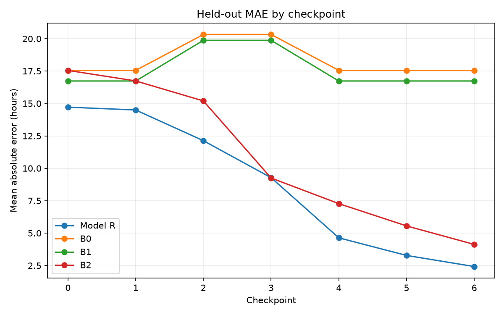

# Aiqon take-home: ETA and delay propagation

*Anchal. Report built only from the repository (README.md, LLD.md, src/, outputs/).*

## 1. Problem and approach

Given a shipment's route, schedule and the milestones observed so far, I predict how late it will be at delivery, a range for that delay, and the probability that it is late, and I explain each prediction. I stack every shipment at checkpoints C0 (nothing observed) to C6 (after customs), so the same model answers at each point in the journey. All models are LightGBM, evaluated on held-out shipments over 5 split seeds (42 to 46), with a 20% shipment-level test split and 5-fold grouped CV.

## 2. Synthetic data, delay injection and propagation

`src/generate.py` builds 300 shipments over 19 route templates from seed 42; 55% connect through one hub. Each stage inherits the lateness of the one before, absorbs part of it, and adds its own: `delay_new = delay_in * (1 - absorb) + own_delay`. The hub is the exception: the cargo either makes the connection (the buffer clears the lateness) or misses the sailing and the delay resets to the wait for the next one. Five causes are planted: missed connection, missed berth slot, congestion above the port's norm, rare storms on one leg, and absorption. The penalty sizes are hidden from the model; it only knows two operational constants (12 h hub connection time and 12 h berth window). Hidden causes go to `truth.csv`, used only for evaluation and explanation. Missing logs are simulated separately (default rate 0.10, only `act_port_done` and `act_customs` can be hidden), and a gap rule flags added delay that spans a hidden stage. A shipment counts as delayed above a 6 hour threshold, which gives 60% delayed at the default seed (LLD.md), so there is no severe class imbalance.

## 3. Features

Route (journey, origin, hub, destination, connecting flag, legs), plan (planned total and leg times, hub buffer, nominal slack, schedule day of week and day of year), port norms (base dwell, customs, congestion), observed stage delays and added delays, `delay_so_far` and number of observed stages, environment (leg weather, hub and port congestion, arrival day), link features (`slack_remaining`, `slot_margin`, congestion times dwell and customs, port-done weekday and weekend flag) and missingness flags. A single visibility map in `checkpoints.py` controls what each checkpoint can see, so realised port congestion is never used before C4.

## 4. Models

- **Baselines:** B0 predicts zero delay, B1 the journey mean from training shipments, B2 `delay_so_far`.
- **Model R:** L1 LightGBM regressor on `remaining_delay_h`, added to `delay_so_far`. Model Q (0.1 and 0.9 quantiles) gives the interval.
- **Model C:** delay classifier (above 6 h). It picks from a 4-candidate grid by shipment-grouped CV log loss (`outputs/metrics/model_c_tuning.csv`): `small` (depth 3, 4 leaves, lr 0.05, min child 15), `medium` (depth 4, 8 leaves, lr 0.05, 15), `regularized` (depth 3, 4 leaves, lr 0.05, 30) and `faster_learning` (depth 4, 8 leaves, lr 0.1, 15). `regularized` won on 4 of 5 split seeds (CV log loss 0.455 to 0.492) and `small` won on seed 44 (0.497). `faster_learning` was worst on every seed. Probabilities are not post-hoc calibrated.

## 5. Results

Held-out means over 5 split seeds. Skill score = 1 - MAE(Model R) / MAE(B2).

| Ckpt | Model R MAE (h) | B2 MAE (h) | Skill | R beats B2 (seeds) | Model C ROC-AUC | Model C Brier | Q coverage (nominal 0.8) |
|---|---|---|---|---|---|---|---|
| C0 | 14.72 ± 1.15 | 17.55 | 0.16 | 5/5 | 0.56 | 0.251 | 0.72 |
| C1 | 14.50 ± 0.88 | 16.74 | 0.13 | 5/5 | 0.56 | 0.254 | 0.69 |
| C2 | 12.13 ± 0.95 | 15.20 | 0.20 | 5/5 | 0.69 | 0.227 | 0.71 |
| C3 | 9.28 ± 2.29 | 9.25 | -0.003 | 2/5 | 0.73 | 0.209 | 0.75 |
| C4 | 4.64 ± 0.41 | 7.27 | 0.36 | 5/5 | 0.90 | 0.124 | 0.67 |
| C5 | 3.28 ± 0.40 | 5.56 | 0.41 | 5/5 | 0.94 | 0.096 | 0.64 |
| C6 | 2.42 ± 0.25 | 4.13 | 0.41 | 5/5 | 0.96 | 0.078 | 0.77 |

Sources: `model_r_vs_b2.csv`, `model_c_classification_metrics.csv`, `model_q_coverage.csv` (all in `outputs/metrics/`).

Model R beats B2 on all 5 seeds at every checkpoint except C3 (after hub departure), where it ties: once the hub outcome is known, `delay_so_far` is already a strong estimate. The gain is largest after port arrival (skill 0.36 to 0.41), where the slot and congestion features matter. B0 and B1 stay between roughly 16.7 and 20.3 h MAE at every checkpoint (read from the plot). Model C ranking is weak before the hub (ROC-AUC 0.56) and strong from port arrival (0.90 or more). Model Q intervals are under-covered (0.64 to 0.77 against 0.8) with no quantile crossings.

**Subgroups** (`model_r_by_group.csv`, C0): connecting shipments 16.74 h MAE vs B2 20.32 h; direct 12.07 h vs 13.93 h; shipments with a hidden stage 17.26 h vs 22.40 h. Model R beats B2 on all 5 seeds in each of these cuts.

**Not available in this run:** the A0/A1/A2 ablation (`model_r_ablations.csv`), the missingness sweep (`model_r_missingness_sweep.csv`), SHAP explanations and the run manifest. The `make all` run behind these outputs stopped before those stages were written. I report no numbers for them.

## 6. SHAP explanations

The design (`src/explain.py`, LLD.md) uses grouped TreeSHAP contributions on held-out Model R predictions, grouped by stage (departure, leg 1, hub, leg 2, port arrival and slot, dwell and congestion, customs, route and plan), combined with observed-stage facts and checked against the planted causes in `truth.csv` (`model_r_explanation_recovery.csv`), plus summary and `slack_remaining` / `slot_margin` dependence plots. These outputs were not produced in this run, so no SHAP plot or recovery figure is included; they come from `make explain`.

## 7. Limitations and next steps

- The data is synthetic. Results show the method recovers planted structure, not real port behaviour, and the generator noise is not calibrated to real data.
- 300 shipments is small; I report means and spread over 5 split seeds rather than one number.
- Missingness is simulated as random; real gaps usually are not. One hub per journey only.
- The optional adjusted slack feature (congestion at the hub) stays off because the LLD gives no formula for it.
- Model C is not calibrated and Model Q under-covers; next I would add calibration and conformal widening, finish the ablation, missingness and SHAP runs, and test on real or calibrated data.

## 8. Reproducibility

`make all` runs data, features, splits, baselines, Models R/Q/C, evaluations, the missingness sweep, explanations and ablations, and writes `outputs/run_manifest.json` with the seed, configuration, Git revision and headline metrics. Single stages: `make data`, `features`, `splits`, `baselines`, `train` (Model R), `eval`, `train-q`, `eval-q`, `train-c`, `eval-c`, `eval-missingness`, `explain`, `test`, `clean`. Defaults (`src/config.py`): seed 42, 300 shipments, delay threshold 6 h, missing rate 0.10, test fraction 0.20, 5 CV folds, 5 split seeds. The run manifest was not written in this run because `make all` did not finish; rerun `make all` to regenerate it.
